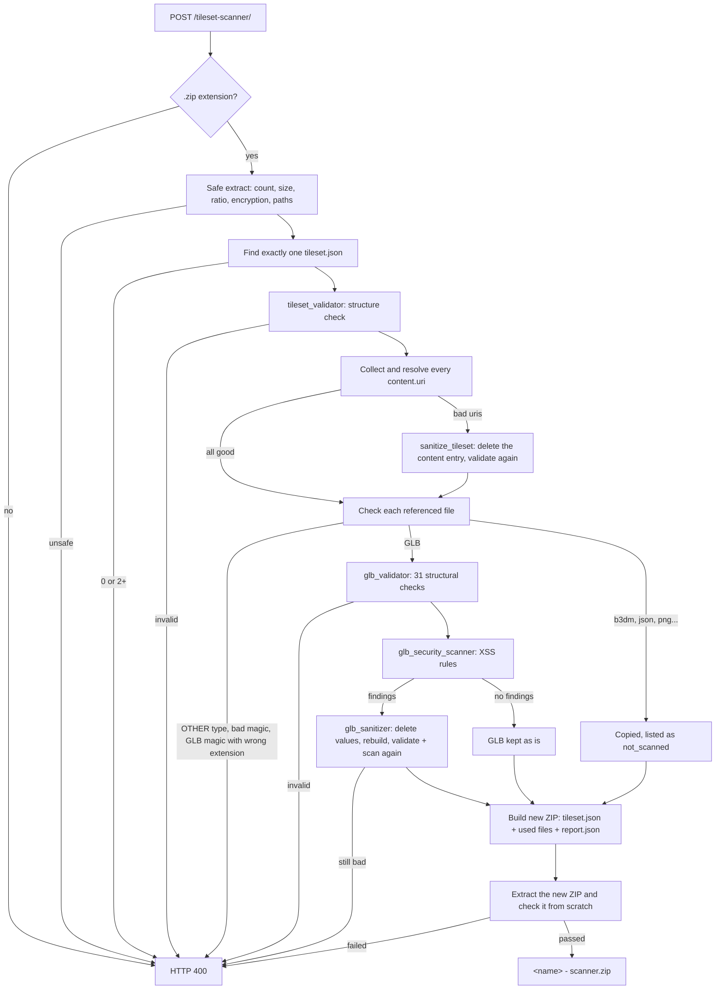

<p align="center">
  
  
</p>

# 3D Tiles Security Scanner

A proof of concept that validates, sanitizes and re-verifies 3D Tiles packages before they reach a viewer.

## The goal

Take a 3D Tiles ZIP (`tileset.json` + GLB models) from an untrusted source, find what can harm the viewer or the server, remove it without breaking the tiles, and return a clean package with a `report.json` of what changed. Anything that can't be cleaned with confidence is rejected, never repaired.

## Threats

| Where | Threat | Example |
|---|---|---|
| ZIP | Zip Slip | `../evil.py`, `/etc/x`, `dir\..\x` entries |
| ZIP | ZIP bomb | tiny archive that expands to gigabytes |
| tileset.json | External resources / SSRF | `https://...`, `//host/...`, `http://169.254.169.254/...`, `file://`, `data:`, `javascript:` |
| tileset.json | Path traversal | `../../etc/passwd`, `%2e%2e/secret.glb`, `/etc/passwd`, `tiles\a.glb` |
| tileset.json | Broken references | a `uri` to a file that is not in the package |
| Package | Disguised files | `.html` / `.exe` content, a PNG named `.glb`, a GLB named `.b3dm` |
| GLB | Parser exploitation | malformed header, chunk lengths or bufferViews past the BIN data (CVE-2023-21782, CVE-2023-21783, CVE-2023-25884, ZDI-24-1088) |
| GLB | Script injection (XSS) | `<script>`, `onload=`, `javascript:` in any JSON string: `asset.generator`, node / mesh / material names, `extras` (CVE-2026-28737) |
| GLB | External embedded buffer | `buffers[0].uri` pointing outside the file |

## Architecture



| Module | Role |
|---|---|
| `main.py` | FastAPI app (v0.2.0): upload, safe extraction, file-type checks, builds the new ZIP, final re-check, response |
| `tileset_validator.py` | `tileset.json` structure, collects every `content.uri` in the tile tree, resolves each one inside the package |
| `sanitize_tileset.py` | Deletes the `content` of tiles with a bad uri, writes the new `tileset.json`, validates it again |
| `glb_validator.py` | GLB 2.0 binary structure: header, chunks, JSON, buffers, bufferViews |
| `glb_security_scanner.py` | Walks every JSON string value and flags XSS patterns with their exact location |
| `glb_sanitizer.py` | Deletes flagged values, rebuilds the GLB with the original BIN, validates and scans it again |

## Defenses

### 1. Safe ZIP handling (`main.py`)

Every entry is checked before anything is extracted. Any failure stops the run.

| Check | Limit | Error |
|---|---|---|
| Upload name | must end with `.zip` (case-insensitive) | `upload a zip file` |
| Readable archive | `zipfile.BadZipFile` | `invalid ZIP file` |
| Entry count | more than 50,000 | `zip contains too many files` |
| Total uncompressed size | more than 500 MiB | `zip is too large` |
| Compression ratio per entry | more than 200:1 | `suspicious zip compression ratio` |
| Encryption | flag bit 0 set | `encrypted ZIP files are not supported` |
| Path | contains `\`, or resolves outside the extract folder (`../`, absolute) | `unsafe path found inside the zip` |
| tileset.json | none found (searched recursively) | `tileset.json file is not inside the zip` |
| tileset.json | more than one | `more than one tileset.json found` |

Each request works in its own `tempfile.TemporaryDirectory`, deleted when the request ends.

### 2. tileset.json validation (`tileset_validator.py`)

Structure, based on the [3D Tiles schema](https://github.com/CesiumGS/3d-tiles/blob/main/specification/schema/tileset.schema.json):

- valid UTF-8 JSON, and the root is an object
- `asset`, `geometricError` and `root` exist
- `asset` is an object and `asset.version` is a string
- `geometricError` is a number ≥ 0
- `root` is an object with `boundingVolume` and `geometricError` (number ≥ 0)
- `root.refine`, if present, is `ADD` or `REPLACE`

A structural failure rejects the package with all findings:

```json
{"detail": {"error": "invalid tileset.json", "findings": ["Missing required field: root.boundingVolume"]}}
```

### 3. Tileset reference checks (`tileset_validator.py`, `sanitize_tileset.py`)

Every tile in the tree is visited recursively (`root`, `root.children[0]`, `root.children[0].children[1]`...). For each `content.uri` (or legacy `content.url`) the checks run in this order:

| # | Step | Rule | Finding message |
|---|---|---|---|
| 1 | Decode | `unquote()` first, so `%2e%2e/` becomes `../` | |
| 2 | External | any scheme or host (`https:`, `//host`, `file:`, `data:`, `javascript:`, `C:`) | `External URI is not allowed` |
| 3 | Backslash | any `\` | `Backslashes in URI are not allowed` |
| 4 | Shape | empty path or starting with `/` | `Empty or absolute URI path` |
| 5 | Boundary | resolved relative to `tileset.json`, must stay inside the extract folder | `URI points outside the ZIP directory` |
| 6 | Exists | the file must be in the package | `Referenced file does not exist inside the ZIP` |

Query strings are ignored for the file lookup (`a.glb?v=2` → `a.glb`).

Sanitizing: the `content` object of each bad tile is deleted, the tile itself stays in the tree. The new `tileset.json` is written and validated again. If it is still invalid or still has bad uris, the package is rejected. When nothing was found, the original `tileset.json` is kept untouched.

### 4. File type checks (`main.py`)

Each resolved file is classified by extension (`get_file_type`) and compared with its first 4 bytes:

| Extension | Type | Handling |
|---|---|---|
| `.glb` | GLB | must start with `glTF`, then validated, scanned and sanitized |
| `.gltf` | GLTF | copied, listed in `not_scanned` |
| `.json` | JSON | copied, listed in `not_scanned` |
| `.b3dm` `.i3dm` `.pnts` `.cmpt` | 3D_TILES | copied, listed in `not_scanned` |
| `.subtree` | SUBTREE | copied, listed in `not_scanned` |
| `.png` `.jpg` `.jpeg` `.webp` | IMAGE | copied, listed in `not_scanned` |
| `.ktx` `.ktx2` | TEXTURE | copied, listed in `not_scanned` |
| anything else | OTHER | rejected: `invalid file in 3D Tiles package: <uri>` |

Also rejected: a `.glb` without `glTF` magic (`invalid glb magic bytes: <uri>`) and `glTF` magic under any other extension (`glb magic bytes with wrong extension: <uri>`).

### 5. GLB structural validation (`glb_validator.py`)

31 structural checks before any value is trusted. A file that fails is rejected, never repaired.

| Part | Checks |
|---|---|
| Header | at least 12 bytes · magic is `glTF` · version is 2 · declared length equals the real file size · at least 20 bytes |
| Chunks | complete 8-byte chunk header · length divisible by 4 · length inside the file · complete chunk data · first chunk is `JSON` · at most one `BIN` · JSON chunk present |
| JSON | valid UTF-8 and JSON · root is an object · `asset` exists and is an object · `asset.version` exists and equals `"2.0"` |
| Buffers | `buffers` is a list · each buffer is an object · `byteLength` exists and is an integer ≥ 0 · `buffers[0]` has no `uri` · BIN chunk present when `buffers[0].byteLength > 0` · BIN length is `byteLength` to `byteLength + 3` (padding) |
| BufferViews | `bufferViews` is a list · each is an object · `buffer` is a valid index · `byteOffset` is an integer ≥ 0 · `byteLength` is an integer ≥ 0 · `byteOffset + byteLength` stays inside the buffer |

Unknown chunk types after the JSON chunk are skipped, as the glTF spec allows. A file that can't be opened returns `file not found` or `permission denied`.

### 6. XSS detection and sanitizing (`glb_security_scanner.py`, `glb_sanitizer.py`)

Every string value in the GLB JSON (any depth, inside objects and lists) is checked, case-insensitive:

| Rule | Regex | Catches |
|---|---|---|
| `SCRIPT_TAG` | `<\s*script\b` | `<script>`, `< script>`, `<SCRIPT>` |
| `HTML_EVENT_HANDLER` | `\bon[a-z]+\s*=` | `onload=`, `onerror =`, `<svg/onload=...>` |
| `JAVASCRIPT_URI` | `javascript\s*:` | `javascript:alert(1)`, `javascript :` |

Words such as `onion`, `description` or `JavaScript tutorial` don't match.

Each finding keeps the rule and its exact location, for example `glb_json.nodes[0].extras.tags[2]`. Sanitizing:

1. Each flagged location is deleted once, even when two rules hit the same value.
2. Deletion runs from the end to the start, so list indexes don't shift.
3. The GLB is rebuilt: new JSON chunk (UTF-8, padded with spaces to a multiple of 4), the original BIN data byte for byte, corrected total length.
4. The rebuilt file is validated and scanned again. If it is broken or still has findings, the package is rejected.

```json
"asset": {"version": "2.0", "generator": "<script>alert(1)</script>"},
"nodes": [{"name": "door onload=x"}],
"extensionsUsed": ["KHR_a", "<script>"]
```
becomes
```json
"asset": {"version": "2.0"},
"nodes": [{}],
"extensionsUsed": ["KHR_a"]
```

### 7. Output and final check (`main.py`)

- The new ZIP holds only `tileset.json`, the files it references and `report.json`. Unreferenced files are dropped. A file used by several tiles is added once. The original folder layout is kept.
- The new ZIP is extracted again with the same safe extraction, its `tileset.json` validated, every uri resolved, and every `.glb` scanned. Any problem returns `package failed the final check`.

## API

### `POST /tileset-scanner/`

`multipart/form-data` with one field, `file`, a `.zip` package.

**200** `application/zip`, sent as `<original name> - scanner.zip` (`Content-Disposition: attachment; filename*=UTF-8''...`, so Hebrew names and spaces work).

**400** with a `detail` string or object explaining the reason. No partial output is returned.

| `detail` | Cause |
|---|---|
| `upload a zip file` | file name doesn't end with `.zip` |
| `invalid ZIP file` | not a readable ZIP |
| `zip contains too many files` · `zip is too large` · `suspicious zip compression ratio` · `encrypted ZIP files are not supported` · `unsafe path found inside the zip` | safe extraction |
| `tileset.json file is not inside the zip` · `more than one tileset.json found` | tileset lookup |
| `{"error": "invalid tileset.json", "findings": [...]}` | structure, or `problems are left after cleaning` |
| `invalid file in 3D Tiles package: <uri>` · `invalid glb magic bytes: <uri>` · `glb magic bytes with wrong extension: <uri>` | file type checks |
| `{"error": "glb could not be sanitized", "file": "<uri>", "reason": "<validator error>"}` | GLB structure, or cleaning failed |
| `package failed the final check` | re-verification of the new ZIP |

### `report.json`

```json
{
  "removed_uris": [
    {
      "uri": "https://evil.example/x.glb",
      "location": "root.children[0].content",
      "file_type": "GLB",
      "status": "ALERT",
      "message": "External URI is not allowed"
    }
  ],
  "sanitized_glbs": [
    {"file": "tiles/a.glb", "removed": ["glb_json.asset.generator", "glb_json.nodes[0].name"]}
  ],
  "not_scanned": ["tiles/b.b3dm"]
}
```

Interactive docs: `http://localhost:8000/docs`

## Run

### Docker

```bash
docker build -t tiles-scanner .
docker run --rm -p 8000:8000 tiles-scanner
```

The image is `python:3.12-slim`, copies only `requirements.txt` and `*.py`, and runs `uvicorn main:app --host 0.0.0.0 --port 8000`.

## Test packages

80 hand-built packages, each with its expected verdict and what it tests in `expected.json`. All 80 currently produce the expected result.

| Folder | Count | Expected | Covers |
|---|---|---|---|
| `valid/` | 20 | returned as is, empty report | single and shared GLB, package in a subfolder, 8-level tree, `%20` and `?v=2` uris, uppercase extension, box / region / sphere volumes, 3D Tiles 1.0, Hebrew names, safe words that look like rules, rich `extras`, unreferenced files dropped, B3DM listed as `not_scanned` |
| `sanitized/` | 30 | cleaned, changes in `report.json` | 12 bad uris (https, internal IP, `//`, `file:`, `data:`, `javascript:`, `../`, `%2e%2e/`, absolute, backslash, missing file, traversal back inside) and 18 XSS cases (generator, copyright, node / mesh / material names, `onerror`, `svg/onload`, mixed case, spaces, nested extras, list items, two rules on one value, two GLBs, XSS + bad uri together, Hebrew + script) |
| `rejected/` | 30 | HTTP 400 | Zip Slip (3), backslash entry, compression ratio, not a ZIP, `.rar`, no / two tilesets, 9 broken tilesets, `.html` and `.exe` content, PNG named `.glb`, GLB named `.b3dm`, 8 broken GLBs |

## Project structure

```
├── main.py                    # FastAPI endpoint and orchestration
├── tileset_validator.py       # tileset.json structure + uri resolution
├── sanitize_tileset.py        # removes bad tile content
├── glb_validator.py           # GLB binary structure
├── glb_security_scanner.py    # XSS rules
├── glb_sanitizer.py           # removes findings, rebuilds the GLB
├── expected.json              # expected verdict for every test package
├── valid/  sanitized/  rejected/
├── requirements.txt
└── Dockerfile
```

## Not covered yet

Each gap below was reproduced against the current code.

**tileset.json**
- Only `content` is followed. A uri in 3D Tiles 1.1 `contents[]` is never checked and survives in the output, and the files it points to are dropped from the package.
- When a tile has both `content.uri` and `content.url`, only `uri` is checked. A bad `url` stays.
- Strings in `tileset.json` (`asset.generator`, `extras`, `properties`) are not scanned for XSS.
- Only the root tile is validated. Children with a negative `geometricError`, an invalid `refine` or no `boundingVolume` pass.
- Nested tilesets (`.json` content) and implicit tiling (`.subtree`, templated uris) are copied but not followed, so the files they reference are dropped.
- The tile tree is walked recursively with no depth limit. A tree around 1,200 levels deep raises `RecursionError` and returns HTTP 500.

**GLB**
- `images[].uri` and `buffers[1+].uri` are not checked: external or `file://` uris pass.
- Accessors are not validated (`count × element size`, `byteStride`, `bufferView` index), so an accessor that reads far past its bufferView passes.
- XSS rules check values only, not keys, and cover three patterns (no `<iframe>`, `vbscript:`, HTML-entity encoded tags).
- B3DM, I3DM, PNTS, CMPT, glTF, images and textures are listed as `not_scanned` and copied as they are (magic bytes are only checked for GLB).

**Service**
- No limit on the upload size before it is written to disk, no limit on JSON size or depth, no tile count limit, no timeout.
- Only `ValueError` and `BadZipFile` are mapped to 400. Other errors return 500.
- The ZIP is identified by its extension only, and the final check identifies GLBs by extension, not magic.
- The ZIP size limit trusts the sizes declared in the archive.
- No automated test runner: `expected.json` has no script or CI job that runs it.

---

Built for [3D Tiles](https://github.com/CesiumGS/3d-tiles) and [glTF 2.0](https://www.khronos.org/gltf).
