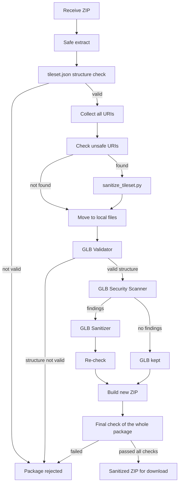

<p align="center">
  
  
</p>

# 3D Tiles Security Scanner

A proof of concept for scanning and sanitizing 3D Tiles packages before they reach a viewer.

## Overview

#### The goal


Take a 3D Tiles ZIP from an untrusted source, find what can harm the viewer or the server, remove it without breaking the tiles, and return a clean package with a report of what changed.

#### Threats in GLB (glTF 2.0)

- **Parser exploitation**: malformed headers, chunk lengths, or bufferViews that point past the BIN data (CVE-2023-21782, CVE-2023-21783, CVE-2023-25884, ZDI-24-1088)
- **Script injection**: `<script>`, `onload=` or `javascript:` hidden in JSON strings like `asset.generator`, node names or `extras` (CVE-2026-28737)
- **External buffer**: the embedded buffer pointing to an outside `uri`

#### Threats in tileset.json

- **External resources**: `content.uri` pointing to `https://...` or an internal address (SSRF)
- **Path traversal**: `../`, `%2e%2e/` or absolute paths leaving the package folder
- **Broken references**: uris to files that are not in the package

#### Threats in the ZIP

- **Zip Slip** and **ZIP bombs**, checked before a single file is written

## Architecture



| Module | Role |
|---|---|
| `main.py` | FastAPI endpoint, safe extraction, builds and re-checks the output |
| `tileset_validator.py` | Tileset structure, resolves every `content.uri` |
| `sanitize_tileset.py` | Removes unsafe references, keeps the tiles |
| `glb_validator.py` | GLB 2.0 binary structure |
| `glb_security_scanner.py` | Finds script patterns in every JSON string |
| `glb_sanitizer.py` | Removes findings, rebuilds the GLB, scans it again |

A file that can't be parsed completely is rejected, never repaired.

## Run with Docker

```
docker build -t tiles-scanner .
docker run --rm -p 8000:8000 tiles-scanner
```

Open `http://localhost:8000/docs` and upload a ZIP to `/tileset-scanner/`. The response is `<name> - scanner.zip` with the cleaned tileset, its files, and `report.json`.

## Not Covered Yet

- Accessor and `byteStride` bounds in GLB
- Image and extra buffer uris inside GLB
- B3DM, I3DM, PNTS, CMPT and nested tilesets (copied as they are, listed as `not_scanned`)

---

Built for [3D Tiles](https://github.com/CesiumGS/3d-tiles) and [glTF 2.0](https://www.khronos.org/gltf).
